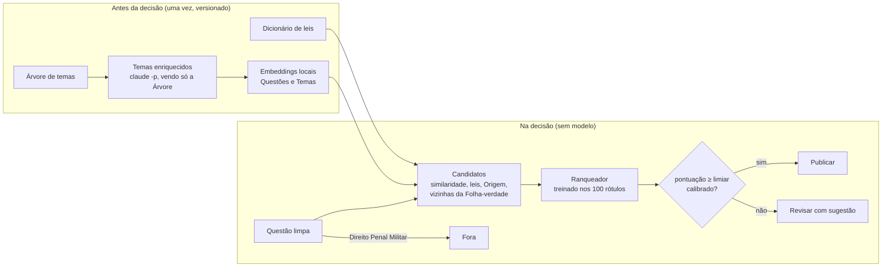

# Classificação de tópicos — case Vício

Classifica 659 questões de Penal, Processo Penal, Legislação Penal Especial e Criminologia na árvore de temas da plataforma e decide, para cada uma, **publicar**, **revisar** ou **fora**, sob a régua de ≥ 95% de precisão nas publicadas. **Nenhum modelo de linguagem escolhe, vota ou valida o tema:** a decisão é de um Ranqueador treinado nas 100 questões da Folha-verdade, e o comando de entrega roda sem rede e sem modelo.

Enunciado e anexos: [`anexos/v2/`](anexos/v2/). Entrega: [`publicacao.csv`](publicacao.csv), [`previsao.txt`](previsao.txt) e [`relatorio.pdf`](relatorio.pdf) (relatório a–d e memo ao Professor na última página, gerado de [`docs/v2/`](docs/v2/)).

> **Versões.** Este repositório guarda as duas etapas do case. A **v2** (esta entrega) está em `src/classificacao/v2/`, `dados/v2/` e `prompts/v2/`. A **v1** (tag `v1`, dois LLMs votando) está em `src/classificacao/v1/`, `dados/v1/` e [`entregas/v1/`](entregas/v1/README.md), e continua regenerando a sua entrega byte a byte. O que as duas compartilham (Árvore e Ramo, Régua, calibração, formato da entrega, leitura e limpeza dos anexos) fica em `src/classificacao/nucleo/`.

## Como roda a decisão

<!-- --8<-- [start:fluxo] -->

<!-- --8<-- [end:fluxo] -->

As decisões estão nas ADRs em [`docs/adr/`](docs/adr/) (a v2 começa na 0008) e na especificação [`docs/specs/v2-sistema-de-classificacao.md`](docs/specs/v2-sistema-de-classificacao.md). O vocabulário está no [`GLOSSARY.md`](GLOSSARY.md).

## Como rodar

Requer [uv](https://docs.astral.sh/uv/).

```bash
uv sync
uv run pytest                          # testes (nenhum chama rede nem modelo)
uv run classificacao v2 entrega        # regenera publicacao.csv e previsao.txt (⟨tempo⟩ s, sem rede)
```

Só isso gera a entrega. Os comandos abaixo **refazem os artefatos** de `dados/v2/`, que já estão versionados:

```bash
uv run classificacao v2 enriquecer             # 1. descreve os 371 Nós com claude -p (só vê a Árvore)
uv run classificacao v2 revisao-temas          # 2. planilha de 30 Temas para revisão humana
uv sync --group embeddings
uv run classificacao v2 embeddings --modelo bge-m3    # 3. vetores locais na CPU
uv run classificacao v2 embeddings --modelo e5-base
uv run classificacao v2 comparar               # 4. validação cruzada dos Ranqueadores (sem modelo)
```

A análise dos dados crus está no notebook [`notebooks/01_analise_dos_dados.ipynb`](notebooks/01_analise_dos_dados.ipynb), com as saídas salvas. Para rodar de novo: `uv sync --group analise`, ou `docker compose up jupyter` (opcional, em http://127.0.0.1:8888).

## De onde veio cada artefato

| Arquivo em `dados/v2/` | Origem | Modelo de linguagem? |
|---|---|---|
| `leis.csv` | Dicionário de 29 leis (número, apelidos, Nós), montado durante o desenvolvimento a partir dos títulos da Árvore e da legislação federal; proposto com assistência de IA e revisado pelo autor | Sim, antes da decisão; revisado |
| `temas_enriquecidos.jsonl` | `classificacao v2 enriquecer`: `claude -p sonnet`, prompt [`prompts/v2/enriquecedor/v1.md`](prompts/v2/enriquecedor/v1.md), rótulo `enriquecedor/v1@hash` em cada linha; o modelo vê só a Árvore de temas | Sim, antes da decisão |
| `revisao_temas.csv` | `classificacao v2 revisao-temas`: 30 Nós (Temas duplicados e maiores Lixeiras) revisados pelo autor | Não |
| `embeddings/<modelo>/` | `classificacao v2 embeddings`: BAAI/bge-m3 e intfloat/multilingual-e5-base na CPU; cada parte tem um manifesto com a revisão do modelo e o hash dos textos | Modelos de embeddings, antes da decisão |
| `comparacao.json` | `classificacao v2 comparar`: validação cruzada na Folha-verdade | Não |
| `escolha.json` | O Ranqueador e os embeddings escolhidos pela comparação | Não |

## Decisões tomadas à mão

- ⟨revisão dos 30 Temas⟩
- **Dicionário de leis** e **regra de Fora para Direito Penal Militar** (a árvore não tem a disciplina; as demais origens erradas não bastam para Fora, por exemplo a Q0016, que vem como Constitucional e é sobre prisão).
- **Alvo de 0,97** para a taxa suavizada no limiar (ADR 0008).
- Nenhuma linha do `publicacao.csv` foi editada à mão.

## Código

Clean Architecture em `src/classificacao/v2/`, com dependências apontando para dentro: `dominio/` (Candidatos, sinais, leis, Origem, decisão, sem I/O, em TDD), `aplicacao/` (montar sinais, Ranqueador, validação cruzada, enriquecimento, entrega), `adaptadores/` (`claude -p`, embeddings locais, cache de vetores, dicionários) e `entrada/` (CLI). Uma versão nunca importa da outra, e um teste de contrato garante que o caminho da entrega não carrega nenhum adaptador de modelo. Os testes estão em `tests/{nucleo,v1,v2}/`.

## Custo e tempo

- **Entrega:** ⟨tempo⟩ s na CPU, sem rede.
- **Enriquecimento:** ~19 chamadas `claude -p sonnet` (assinatura), uma única vez.
- **Embeddings:** ⟨tempo⟩ min na CPU para cada modelo, uma vez.
