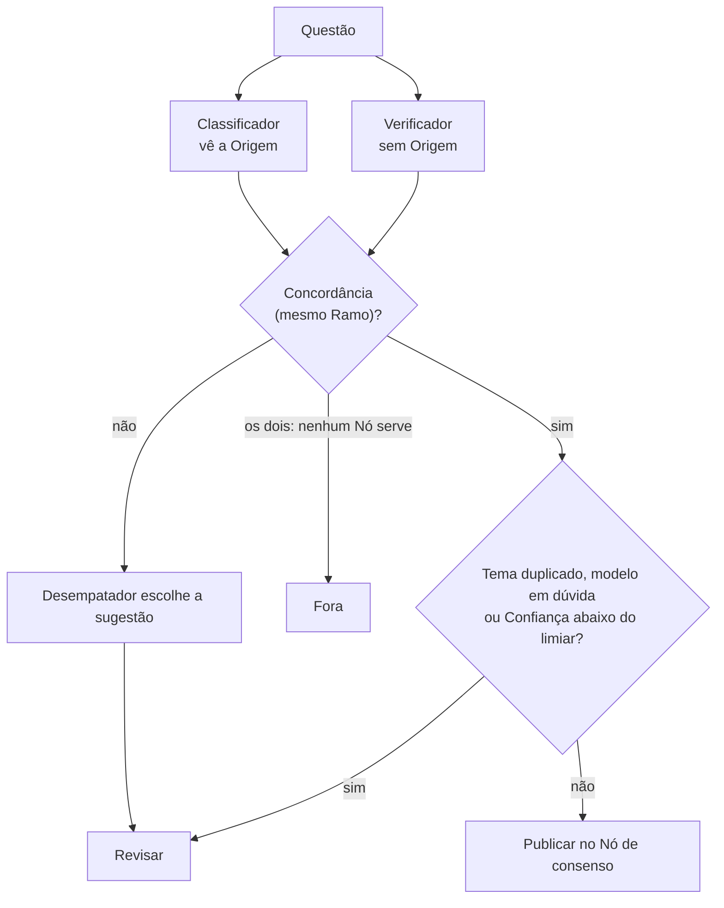

# Publicar só com Concordância entre provedores diferentes

Uma Questão só recebe a Decisão Publicar quando o Classificador (Anthropic) e o Verificador (DeepSeek), modelos de famílias diferentes e com entradas diferentes (só o Classificador vê a Origem), apontam Nós do mesmo Ramo **e** a Confiança calibrada passa do limiar. O limiar é calibrado na amostra rotulada às cegas pelo usuário mirando 97% de Precisão pontual, não 95%, porque com cerca de 50 rótulos o intervalo é largo e mirar a Régua exata dá cerca de 50% de chance de estourá-la.

Regras que decorrem disso e que parecem estranhas sem contexto:

- **O Desempatador nunca publica.** Ele só entra no desacordo e escolhe a sugestão que vai para o Professor. Desacordo marca as Questões difíceis, e publicá-las arrisca a Régua.
- **Na dúvida entre Subtemas irmãos, publica-se no Tema pai.** Pela Régua, o Tema pai acerta qualquer um dos filhos, enquanto um Subtema errado é erro.
- **Nunca se publica numa Disciplina.** Isso recriaria a Lixeira que o case critica, e não é claro que conte como mesmo Ramo.
- **Nunca se publica em Tema duplicado.** A árvore tem 8 Temas com o mesmo título em duas Disciplinas (ex.: Lavagem de Dinheiro em Penal e em Legislação Especial). Cada lado é um Ramo diferente, então dois modelos concordando no lado que o especialista não usa geram um erro sistemático com confiança alta. Até a amostra rotulada revelar a convenção dos especialistas, essas Questões vão para Revisar (achado do piloto, Q0112).
- **Um modelo em dúvida barra a publicação.** Se o Classificador ou o Verificador declaram confiança abaixo de 0,5, a Questão vai para Revisar mesmo com Concordância. No piloto, Questões que misturam cinco assuntos tiveram Concordância com confiança 0,2 (Q0288); a pontuação, dominada pela Concordância, as publicaria.
- **A previsão nunca é mais confiante do que a amostra permite.** O bootstrap do procedimento só reamostra os rótulos que existem. Numa amostra sem nenhum erro, ele diria precisão 1,00 com intervalo 1,00–1,00, e foi o que aconteceu na entrega: 34 de 34 certas. Por isso o ponto previsto é o menor entre o bootstrap e (acertos + 1) / (n + 2), a suavização de Laplace sobre os rotulados acima do limiar, e o intervalo é a união do bootstrap com o intervalo de Wilson desses rotulados. Com 34 de 34, a previsão é 0,97, de 0,90 a 1,00: a amostra não basta para garantir a Régua com 95% de confiança, e a previsão diz isso.
- **A coluna `confianca` segue a mesma regra.** Em Publicar, é a taxa de acerto suavizada por Laplace da faixa de pontuação. Faixas empatadas se unem, e com 34 de 34 dá 0,97. Em Revisar e Fora, é a taxa suavizada das Questões da Amostra com a mesma decisão e o mesmo motivo, e sem nenhuma na Amostra dá 0,50. O intervalo de cobertura só conta Questões que algum limiar publicaria.
- **Fora exige que os dois modelos concordem** que nenhum Nó serve; qualquer dúvida vai para Revisar.
- **O modo de teste não gera a entrega.** No backend `claude-code` os três papéis viram Claude e a independência se perde, então ele serve só para testes. A exceção é quando falta a chave de algum provedor na data final: aí o fallback é declarado no relatório e a calibração é refeita nessa configuração.

## Considered Options

- Deixar o Desempatador publicar: descartado, porque aumenta a cobertura justamente nas Questões de maior risco.
- Um único modelo com limiar de autoconfiança: descartado, porque a autoconfiança declarada por um LLM é mal calibrada e não oferece um segundo sinal independente.
