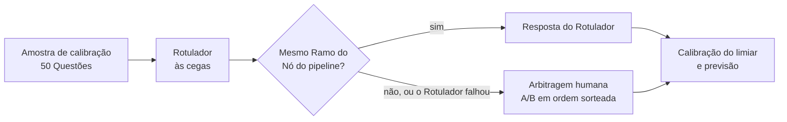

# Rotulagem assistida: o Rotulador responde a amostra, o humano arbitra só os Conflitos

A Amostra de calibração (50 Questões, `dados/rotulagem.csv`) é respondida primeiro por um Rotulador, o modelo mais forte disponível (Opus), fora dos papéis do pipeline. Ele vê a Questão e a Árvore de temas, mas não vê a Origem nem os votos, e tem prompt próprio e versionado (`prompts/rotulador/`, ADR 0003). Há Conflito quando o rótulo do Rotulador fica fora do Ramo do Nó que o pipeline usaria: o consenso, ou a sugestão do Juiz no desacordo. Só os Conflitos, mais as Questões em que o Rotulador falhou, vão para o humano, numa planilha (`dados/arbitragem.csv`) com as duas respostas como opções A e B em ordem sorteada, sem dizer qual veio de onde. O humano escolhe A, B, outro Nó ou "nenhum". `classificacao consolidar` grava as respostas na amostra, com a fonte de cada uma na coluna `observacao` (`rotulador` ou `arbitragem`).

O motivo é concentrar o julgamento humano onde ele muda o resultado. Rotular 50 Questões contra 377 Nós é caro, e na maior parte delas o rótulo humano só confirmaria o que dois modelos já disseram. O que decide a calibração são as Questões em que o pipeline pode estar errado, e é ali que o humano entra.

## Limitação declarada

**O Rotulador é da mesma família do Classificador** (Opus e Sonnet, ambos Claude). Erros que os dois cometem juntos não geram Conflito, chegam à amostra como acerto e deixam a Precisão estimada otimista. É o mesmo risco que o ADR 0002 combate no pipeline. As mitigações são parciais:

- O Rotulador não vê a Origem, que é a entrada que mais aproxima os erros do Classificador.
- O Rotulador é de outro porte (Opus) e tem outro prompt (o de quem monta o gabarito).
- Na arbitragem, o humano não sabe qual opção é do pipeline, o que evita ancorar na resposta da máquina.
- Resposta que um humano já preencheu na amostra nunca é sobrescrita: rotular mais Questões à mão sempre melhora a amostra.

**Protocolo de cegueira.** Quem arbitra ou audita a amostra faz isso antes de abrir a página de Resultados do site ou o `dados/rodada/resumo.csv`, que mostram o Nó do pipeline de todas as Questões. Esconder essa informação no site não protegeria nada, porque o `resumo.csv` está no repositório público, e deixaria a análise incompleta para quem avalia.

O relatório declara essa limitação junto da previsão. A correção completa é o humano revisar também uma parte sorteada das respostas sem Conflito (`observacao = rotulador`), o que entra na seção de produção como auditoria amostral.

## Considered Options

- **Humano rotula as 50 sozinho:** é o padrão-ouro, mas custa o tempo de especialista que o case trata como escasso.
- **Rotulador sozinho, sem humano:** descartado, porque a previsão viraria a opinião de um modelo sobre outros modelos, sem nenhum julgamento humano.
- **Mostrar ao humano qual opção é do pipeline:** descartado, porque ancora a escolha na resposta da máquina.
