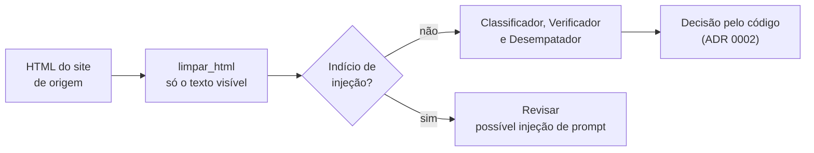

# Texto da Questão é dado, nunca instrução: limpar o invisível e desviar indícios de injeção

O texto de cada Questão vem de um site de terceiros e vai dentro do prompt dos modelos. Ele é dado a classificar, nunca instrução. Duas defesas no código, antes de qualquer modelo, garantem isso. Elas não dependem de o modelo obedecer ao prompt.

1. **Limpeza do que o aluno não vê** (`limpar_html`, em `adaptadores/anexos.py`). Só chega ao modelo o texto que o navegador mostraria. Saem os comentários HTML, inclusive os condicionais do Word (`<!--[if gte mso 9]>…<![endif]-->`). Saem também os elementos `style`, `script`, `xml`, `template`, `head`, `noscript` e `title`, e os elementos escondidos por `hidden`, `display:none`, `visibility:hidden`, ou por fonte ou opacidade zero. Por fim, saem os caracteres de controle e de formatação Unicode: largura zero, inversão bidirecional, hífen invisível e caracteres de tag.
2. **Indício de injeção** (`dominio/injecao.py`). Um texto que fala com o modelo em vez de com o aluno é um indício: uma ordem para ignorar instruções, para classificar num Nó ou para responder em JSON, campos do voto (`no_id`), marcadores de papel (`<|…|>`, `[INST]`, `System:`), os cabeçalhos do nosso próprio prompt (`## Origem`) ou ids no formato da Árvore (`[4703]`). Uma Questão com indício **não é enviada a nenhum modelo**: nem ao Classificador, nem ao Verificador, nem ao Desempatador, nem ao Rotulador. Ela vai para **Revisar** com o motivo `possível injeção de prompt (<campo>: <tipo>)`, e a sugestão é o Nó mais parecido pelos embeddings, que não seguem instruções. O Rotulador também não a recebe.

## Por que Revisar e não Fora

Fora afirma que nenhum Nó da Árvore serve, e vai para o aluno como decisão final sem passar por ninguém. Uma Questão com texto suspeito pode muito bem ser uma questão penal legítima, adulterada ou mal colada. Quem decide é o Professor, que vê o texto como o aluno veria e o motivo do desvio. Revisar custa uma Questão na fila; Fora errado tira uma questão boa do aluno sem que ninguém perceba.

## Por que não deixar o modelo resistir sozinho

O prompt da v2 também vai dizer que o texto da Questão é dado. Mas uma defesa que depende de o modelo obedecer é exatamente a que a injeção ataca. As defesas daqui são código determinístico, testado e igual para todo provedor. Elas se somam às que já existiam: saída presa a um schema JSON, ids validados contra a Árvore, Publicar só com a Concordância de dois provedores, e decisão tomada pelo código, nunca pelo modelo.

## Medido nos dados do case

- **Limpeza:** muda só duas das 359 Questões. Na Q0099, as alternativas B, C e D levavam cerca de 700 caracteres de metadados e CSS do Word cada uma ("Normal 0 false 21 … table.MsoNormalTable {mso-style-name: …}"). Esse texto o aluno não vê e o modelo lia, e é exatamente por aí que uma instrução escondida passaria. Na Q0030, um hífen invisível partia "assegurado".
- **Indício de injeção:** nenhuma das 359 Questões dispara. Os padrões foram escritos e testados contra o vocabulário jurídico que parece instrução: "assistente de acusação", "o juiz deve ignorar a prova", "abuso de confiança", "classifique o crime".

## Considered Options

- **Mandar para Fora:** descartado, pelos motivos acima.
- **Classificar mesmo assim e só impedir a publicação:** o voto ainda seria escrito por um modelo exposto à instrução, e a sugestão que o Professor recebe poderia ser a que o atacante escolheu. Os embeddings dão a sugestão sem esse risco.
- **Pedir a um modelo que detecte injeção:** é um classificador sujeito ao mesmo ataque, custa uma chamada por Questão e não é determinístico. Os padrões são estreitos, auditáveis e não disparam em nenhuma Questão real.
- **Sanitizar o trecho suspeito e classificar o resto:** esconde o problema do Professor e aposta que o padrão pegou o trecho inteiro.
