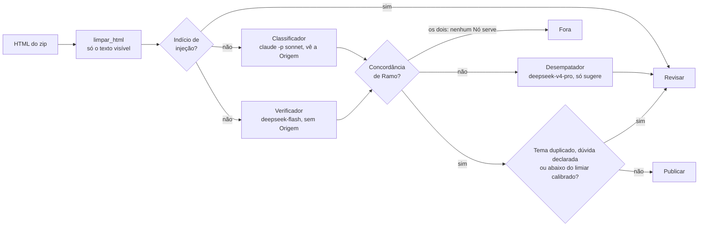

# Classificação de tópicos — case Vício (v1, primeira etapa)

> Este é o README da **v1**, guardado com a sua entrega. A entrega vigente é a v2: veja o [README da raiz](../../README.md).

Classifica 359 questões de Penal, Processo Penal, Legislação Penal Especial e Criminologia na árvore de temas da plataforma e decide, para cada uma, **publicar**, **revisar** ou **fora**, sob a régua de ≥ 95% de precisão nas publicadas. Enunciado: [`anexos/v1/case-ia-classificacao-de-topicos.pdf`](../../anexos/v1/case-ia-classificacao-de-topicos.pdf). Dados: [`anexos/v1/anexos-case-ia.zip`](../../anexos/v1/anexos-case-ia.zip) (lido direto, sem extrair).

> **Versões.** Este repositório guarda as duas etapas do case lado a lado. A **v1** (esta entrega, tag `v1`) está em `src/classificacao/v1/`, `dados/v1/`, `prompts/v1/` e `entregas/v1/`. A **v2**, etapa complementar em que nenhum modelo de linguagem decide o tema, será construída em `src/classificacao/v2/`. O que as duas compartilham (Árvore de temas e Ramo, calibração, formato da entrega, leitura e limpeza dos anexos) fica em `src/classificacao/nucleo/`. Os arquivos da entrega na raiz (`publicacao.csv`, `previsao.txt`, `relatorio.pdf`) são, por enquanto, os da v1, iguais aos de `entregas/v1/`.

**Relatório para leitura: [`relatorio.pdf`](../../relatorio.pdf)** (5 páginas A4, com as seções a) a c) e o memo ao Professor na última página). Ele é gerado de [`docs/v1/relatorio.md`](../../docs/v1/relatorio.md) e [`docs/v1/memo-professor.md`](../../docs/v1/memo-professor.md) por `uv run python scripts/gerar_relatorio_pdf.py v1` (precisa de um Chrome ou Chromium; passe o caminho ou defina `CHROME`).

> **Configuração usada na entrega:** Classificador = `claude -p` com `sonnet` (assinatura Claude Code, sem chave da API da Anthropic), Verificador = `deepseek-flash`, Desempatador = `deepseek-v4-pro`, embeddings = `gemini-embedding-2`. Classificador e Verificador são de famílias diferentes, que é o que a regra de publicação exige (ADR 0002). O Verificador planejado era o `gemini-3.8-flash`, mas a chave do Gemini disponível é do plano gratuito, que permite 20 chamadas por dia. A tentativa parou na 29ª Questão, e a rodada completa com DeepSeek foi mantida. A calibração foi feita nessa mesma configuração.

### A solução do case inteira: classifica as 359 Questões na Árvore de temas e decide Publicar, Revisar ou Fora sob a Régua.



```text
src/classificacao/
├── cli.py            # `classificacao v1 <comando>`: escolhe a CLI da versão
├── nucleo/           # comum às versões: Árvore e Ramo, calibração (Wilson + bootstrap), entrega, zip
└── v1/
    ├── dominio/      # decidir por votos, pontuação, indício de injeção
    ├── aplicacao/    # classificar_questao, processar_lote, sinais, amostra cega, Rotulador
    ├── adaptadores/  # claude -p, DeepSeek, Gemini, planilhas, cache/DLQ em arquivo
    └── entrada/      # CLI (rodada, sinais, amostra, rotular, entrega) e páginas do site
anexos/v1/            # enunciado e zip da v1
prompts/v1/           # um prompt versionado por papel (ADR 0003)
dados/v1/             # rodada, sinais, Amostra rotulada, cache: tudo reproduzível sem chamar modelo
entregas/v1/          # publicacao.csv, previsao.txt e relatorio.pdf da v1
docs/                 # relatório, memo ao Professor, ADRs 0001–0007, site MkDocs
```

As decisões estão nos ADRs: sem mensageria nem banco (0001), publicar só com Concordância entre provedores (0002), prompts versionados (0003), texto da Questão como dado e nunca como instrução (0005) Amostra rotulada por agente jurídico, GPT 5.6 Terra (0006, que substitui o 0004) e o desenho de produção para 50 mil Questões por semana (0007).


## Como funciona, em uma frase por etapa

1. **Classificador** (Anthropic, Sonnet via `claude -p`) escolhe o nó da árvore vendo a questão e a classificação de origem.
2. **Verificador** (DeepSeek, `deepseek-flash`) escolhe de forma independente, **sem** ver a origem nem o Classificador.
3. **Desempatador** (DeepSeek, `deepseek-v4-pro`) só entra quando os dois discordam, e só escolhe a sugestão que vai para o professor: **nunca publica**.
4. **Embeddings** (Gemini, `gemini-embedding-2`) dão um sinal extra (similaridade) e uma sugestão de reserva.
5. **Publica** só quem tem concordância de ramo entre dois provedores diferentes, nenhum modelo em dúvida, tema não duplicado e pontuação acima do limiar calibrado numa Amostra de 50 rotulada às cegas por um agente jurídico de IA (ADR 0006), mirando 97%.

As regras e o porquê de cada uma estão em [`docs/adr/`](../../docs/adr/); o vocabulário, em [`GLOSSARY.md`](../../GLOSSARY.md).

Para ler o raciocínio e os resultados sem abrir o código, há um site em [edcastanha.github.io/case-vicio-ia-poc](https://edcastanha.github.io/case-vicio-ia-poc/), gerado destes mesmos arquivos com MkDocs. Para ver localmente: `uv run mkdocs serve`. O site tem também uma apresentação interativa de 9 slides (`docs/apresentacao/`, feita com HyperFrames): use as setas ou aperte P para o modo apresentador. Os números do deck ficam em dois blocos JSON (a entrega e a projeção de produção do ADR 0007), e `tests/v1/contrato/test_apresentacao.py` confere que eles batem com `dados/v1/` e com a entrega. O player 0.8.116, o GSAP e a fonte Inter ficam guardados no repositório, com as licenças em `docs/apresentacao/vendor/LICENCAS.md`. Para validar a composição: `npx hyperframes@0.8.116 check docs/apresentacao/composition`.

## Como rodar

Requer [uv](https://docs.astral.sh/uv/) e as três chaves de API.

```bash
uv sync
cp .env.example .env              # preencha as chaves
uv run pytest                     # testes (nenhum chama rede)

uv run classificacao v1 rodada       # 1. classifica as 359 (retomável; cache em dados/v1/cache)
uv run classificacao v1 sinais       # 2. embeddings: similaridade e reserva
uv run classificacao v1 amostra      # 3. gera dados/v1/rotulagem.csv (50 questões, cega)
#                                   4. preencha `resposta` (id do nó, "id — caminho" de um candidato
#                                      ou "nenhum"); neste case, por um agente jurídico (ADR 0006)
uv run classificacao v1 rotular      # 5. opcional: o Rotulador (Opus) responde às cegas, como segunda opinião
uv run classificacao v1 entrega      # 6. calibra nos rótulos e grava entregas/v1/publicacao.csv e previsao.txt
```

O que gera o `publicacao.csv`: o passo 6, que também escreve no `previsao.txt` a explicação de como chegou nos números, a partir de `dados/v1/rodada/classificacoes.jsonl` (passo 1), `dados/v1/rodada/sinais.json` (passo 2) e `dados/v1/rotulagem.csv` (passos 3 e 4). Falhas de provedor vão para `dados/v1/rodada/falhas.jsonl` e a questão termina em `revisar`; a entrega se recusa a gravar um arquivo fora do formato do LEIA-ME.

## Prompts

O prompt de cada papel fica em [`prompts/v1/<papel>/<versao>.md`](../../prompts/v1/), e a versão ativa, em [`prompts/v1/versoes.toml`](../../prompts/v1/versoes.toml). Para testar uma versão nova, crie `prompts/v1/classificador/v2.md` e rode o piloto com `CLASSIFICADOR_PROMPT=v2`. Uma versão publicada nunca é editada (ADR 0003). Cada voto grava o prompt que o gerou (`classificador/v1@dce3cb01`), e `entrega` recusa rodadas com versões misturadas: mudou o prompt, refaça a rodada e a calibração.

`uv run classificacao v1 piloto --n 30` roda uma amostra; com `*_BACKEND=claude-code` no `.env` usa o `claude -p` local em vez das APIs (só para teste).

## Código

Clean Architecture em `src/classificacao/v1/` (e no `nucleo/`, que ela usa), com dependências apontando para dentro:

| Camada | O que tem |
|---|---|
| `dominio/` | árvore e regra do ramo, decisão (publicar/revisar/fora), pontuação, calibração (limiar, bootstrap, curva), validação da entrega |
| `aplicacao/` | casos de uso (classificar questão, processar lote, sinais, amostra cega, calibração, entrega), portas e prompts |
| `adaptadores/` | Anthropic, Gemini, DeepSeek, `claude -p`, leitura do zip, planilha de rotulagem, cache/DLQ/registro em arquivo |
| `entrada/` | linha de comando, configuração por `.env` e páginas geradas do site (`site.py`, chamado por `docs/hooks/site.py`) |

Testes em `tests/nucleo/` e `tests/v1/`, cada um com `unit/` (regras, com fakes) e `contrato/` (adaptadores, com respostas gravadas e o zip real).

## Decisões tomadas à mão

- **Rótulos da amostra de calibração** (`dados/v1/rotulagem.csv`): as 50 foram rotuladas por um agente de IA especializado (GPT 5.6 Terra, de outra família que os modelos do pipeline), com uma skill para questões jurídicas, com a justificativa de cada uma em `observacao`. Não houve especialista humano em Direito (ADR 0006). Limitações declaradas: o gabarito da calibração é de um modelo, e os 50 rótulos saíram da lista de candidatos da planilha, que sempre contém os Nós votados pelo pipeline. As duas coisas puxam a Precisão prevista para cima.
- **Nenhuma linha do `publicacao.csv` foi editada à mão.** Decisão, tema, extras, confiança e motivo saem inteiros do passo 6. As regras que decidem também foram escolhas nossas, e cada uma está num ADR: publicar só com Concordância de Ramo entre provedores, mirar 97% para ter margem sobre os 95% da Régua, e nunca publicar em Tema duplicado nem com dúvida declarada (ADR 0002).
- **Verificador DeepSeek em vez de Gemini.** O plano gratuito do Gemini parou na 29ª Questão (20 chamadas por dia). A rodada inteira ficou com DeepSeek, para a calibração medir um sistema só.
- **Reclassificação da Q0030 e da Q0099**, depois que a limpeza nova tirou o lixo do Word que só elas tinham (ADR 0005). As outras 357 Questões ficaram com o mesmo texto e com o voto do cache.

## Modelos, custo e tempo

**Tempo.** A rodada das 359 levou cerca de 3h45 de relógio (16/10/2026, das 00:20 às 04:05, pelos horários do cache), com 2 Questões em paralelo. O que limita é o `claude -p` da assinatura. Os embeddings dependem da cota gratuita do Gemini (100 textos por minuto), e o passo 6 (`entrega`, com 1.000 reamostras do bootstrap) leva segundos. Rotular a Amostra de 50 com o agente jurídico foi feito fora do código. Refazer tudo a partir de `dados/v1/` não chama nenhum modelo.

**DeepSeek (Verificador e Desempatador), painel de uso da conta em 18/10/2026:** US$ 3,04 em 439 requisições e 6.475.840 tokens. O número é acumulado desde a primeira chamada: inclui os testes de fumaça e as reclassificações. A rodada responde por 420 dessas requisições (359 do Verificador e 61 do Desempatador, que só entra nos desacordos), e a reclassificação da Q0030 e da Q0099 depois da limpeza (ADR 0005) por mais 2.

| | Valor |
|---|---|
| Custo por requisição | US$ 0,0069 |
| Tokens por requisição | ~14,8 mil (a Árvore de temas inteira vai no system prompt) |
| Requisições por Questão | 1,17 (o Desempatador em 17% delas) |
| Custo DeepSeek por Questão | até US$ 0,0085 (teto: divide o total, testes incluídos, pelas 359) |

**Embeddings (`gemini-embedding-2`):** cota gratuita do Gemini, sem custo. O que limita é a cota: 100 textos por minuto e um teto diário. Uma rodada de `sinais` vetoriza cerca de 730 textos (359 Questões e 371 Nós).

**Classificador (`claude -p` com `sonnet`, assinatura Claude Code):** não gera cobrança por chamada. O `claude -p` informa um custo equivalente ao preço da API: US$ 5,84 no piloto de 30 Questões (~5 min), ou US$ 0,19 por Questão. É mais de 20 vezes o custo da DeepSeek por Questão, e é o que pesa na projeção para produção. Lá, com candidatos por embeddings e um Classificador treinado como primeiro voto, a conta cai de US$ 0,20 para cerca de US$ 0,009 por Questão (ADR 0007 e relatório, seção c).
